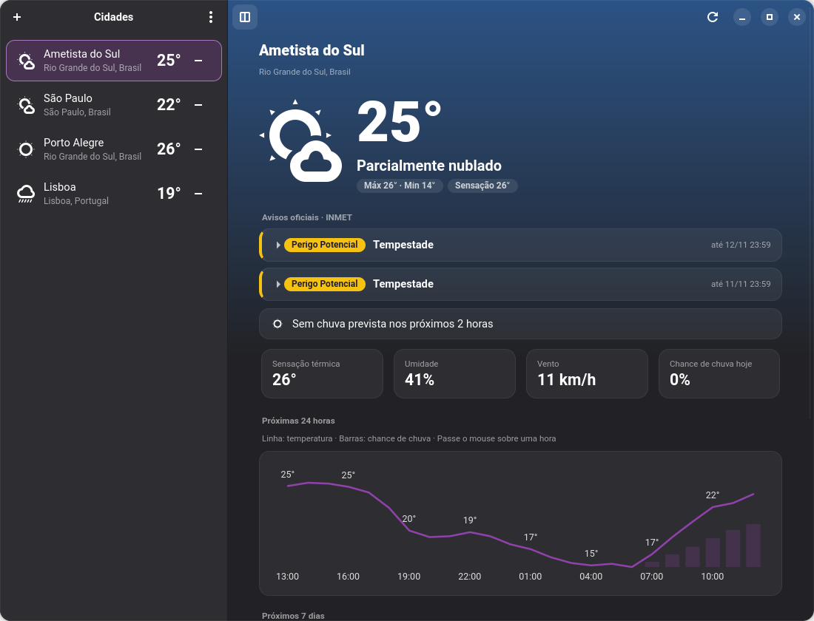
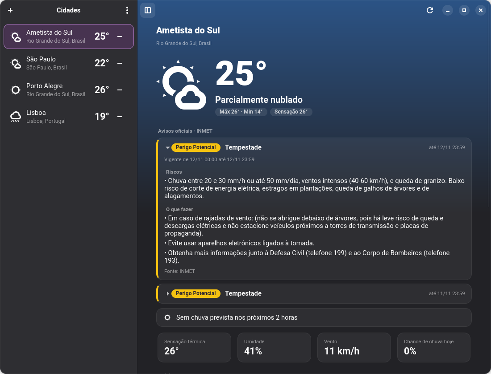
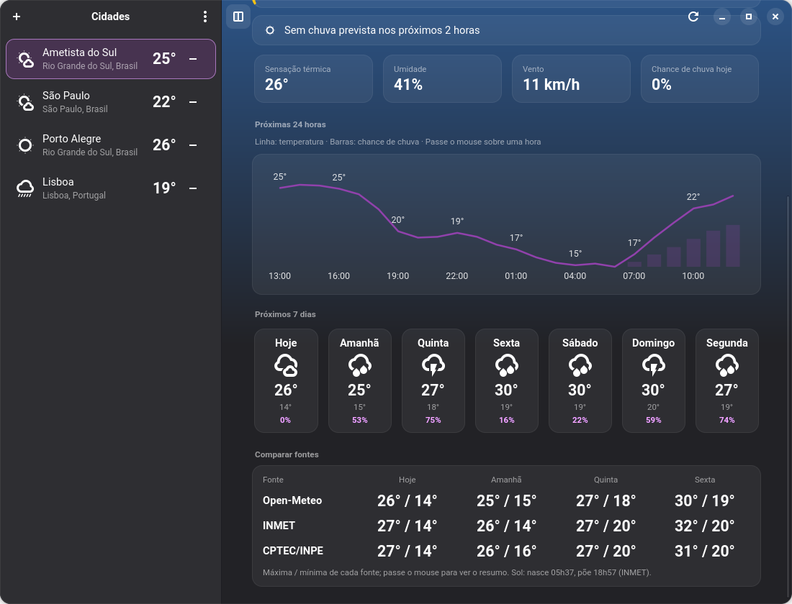
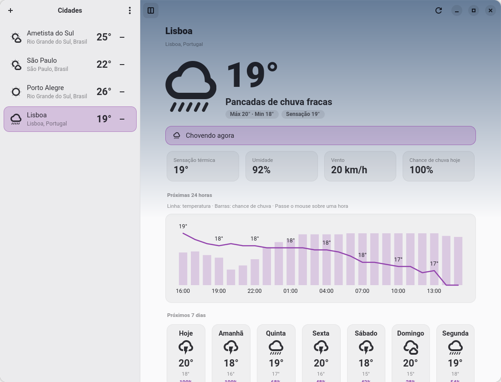
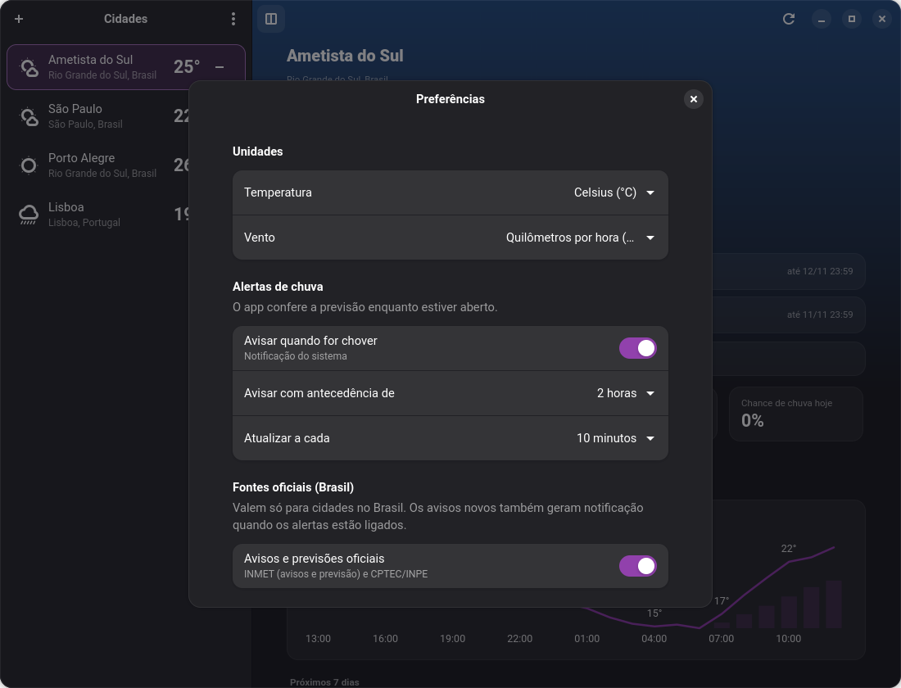

<div align="center">


# Clima

**Previsão do tempo para o GNOME, com cara de app nativo.**
Clima agora, próximas 24 horas, 7 dias, várias cidades — e, no Brasil, avisos oficiais do INMET e comparação entre previsões.




</div>

---

## ✨ Funcionalidades

| | Recurso | Detalhe |
|---|---|---|
| 🌤️ | **Clima agora** | Temperatura grande, sensação térmica, umidade, vento e chance de chuva, com o fundo mudando conforme o tempo (céu limpo, noite, nublado, chuva, tempestade, neve, neblina) |
| 📈 | **Próximas 24 horas** | Gráfico de temperatura com a chance de chuva em barras; passe o mouse numa hora para ver os detalhes |
| 🗓️ | **7 dias** | Máxima, mínima e chance de chuva de cada dia, com dica ao passar o mouse |
| 🏙️ | **Várias cidades** | Busca por nome; a barra lateral mostra o ícone e a temperatura atual de cada uma |
| 🇧🇷 | **Avisos do INMET** | Alertas oficiais que cobrem a cidade, com severidade, riscos e o que fazer |
| ⚖️ | **Comparar fontes** | Máxima e mínima lado a lado: Open-Meteo, INMET e CPTEC/INPE |
| 🔔 | **Notificações** | Aviso de chuva nas próximas horas e de aviso novo do INMET |
| ⚙️ | **Preferências** | °C/°F, km/h, mph ou m/s, antecedência do alerta, intervalo de atualização e fontes oficiais |
| 🎨 | **Visual do Gavetta** | Cards translúcidos, cantos arredondados e chips em pílula, como no [Gavetta](https://github.com/bcocheto/gavetta) e na [Cadência](https://github.com/bcocheto/cadencia) |
| 🌗 | **Cores do sistema** | Segue o tema claro/escuro e a cor de destaque do GNOME |

## 📸 Capturas

<table>
  <tr>
    <td align="center"><br><sub>Aviso oficial do INMET, com riscos e orientações</sub></td>
    <td align="center"><br><sub>Previsão de 7 dias e comparação entre fontes</sub></td>
  </tr>
  <tr>
    <td align="center"><br><sub>Tema claro, com fundo de chuva</sub></td>
    <td align="center"><br><sub>Preferências: unidades, alertas e fontes oficiais</sub></td>
  </tr>
</table>

## 📦 Instalação

> Requer **GTK 4.14+**, **libadwaita 1.6+** e **PyGObject** (`python3-gi`). Testado no GNOME 50.

```bash
git clone https://github.com/bcocheto/clima.git
cd clima
python3 -m clima        # rodar direto
make install            # opcional: atalho no menu, ícone e notificações
```

`make uninstall` remove o atalho e os ícones. As cidades e as preferências ficam em `~/.config/clima/`.

### Flatpak

O manifesto está em [`packaging/flatpak`](packaging/flatpak/io.github.bcocheto.Clima.yaml). Para compilar e instalar localmente (precisa do `flatpak-builder` e do runtime `org.gnome.Sdk//50`):

```bash
flatpak-builder --user --install --force-clean build-flatpak packaging/flatpak/io.github.bcocheto.Clima.yaml
flatpak run io.github.bcocheto.Clima
```

## 🌐 Fontes de dados

| Fonte | Uso |
|---|---|
| [Open-Meteo](https://open-meteo.com) | Previsão principal e busca de cidades (sem chave de API) |
| [INMET](https://apiprevmet3.inmet.gov.br) | Avisos ativos e previsão por município — só cidades no Brasil |
| [CPTEC/INPE](https://brasilapi.com.br) via BrasilAPI | Previsão de 4 dias com índice UV — só cidades no Brasil |
| [IBGE](https://servicodados.ibge.gov.br) | Código do município (usado pelo INMET), guardado em `~/.cache/clima/` |

As fontes oficiais valem para cidades no Brasil e podem ser desligadas nas Preferências. O app só consulta essas APIs; nada é enviado além do nome ou das coordenadas da cidade.

## 🧩 Como funciona

```
Open-Meteo ──► modelo ──► janela (tempo agora, 24 h, 7 dias, cidades)
INMET / CPTEC / IBGE ──► fontes ──► avisos e comparação (cidades no Brasil)
config + store ──► preferências e cidades salvas
```

- `api.py`: Open-Meteo (previsão e busca de cidades).
- `fontes.py`: INMET, CPTEC/INPE e IBGE (funções puras testáveis, sem rede nos testes).
- `modelo.py`: horas, dias e chuva próxima a partir da resposta da API.
- `janela.py` e `busca.py`: a interface; `grafico.py` desenha o gráfico com GtkSnapshot.
- `estilo.css`: o visual, com as cores do tema do sistema.
- `config.py`, `prefs.py` e `store.py`: preferências e cidades.

## 🛠️ Desenvolvimento

| Comando | O que faz |
|---|---|
| `python3 -m clima` | Roda o app direto do código-fonte |
| `make test` | Roda os testes (`unittest`) |
| `make install` | Instala o atalho, os ícones e o `.desktop` para o seu usuário |
| `make uninstall` | Remove o que o `make install` instalou |
| `meson setup build && meson install -C build` | Instalação padrão (usada pelo Flatpak) |

## 🗺️ Próximos passos

- [x] Clima atual, 24 horas e 7 dias
- [x] Várias cidades, preferências e alerta de chuva
- [x] Avisos e previsões oficiais do Brasil (INMET, CPTEC/INPE)
- [ ] Dados observados das estações do INMET (a API pública está sem resposta)
- [ ] Localização automática
- [x] Tela Sobre, metadados AppStream e manifesto Flatpak
- [ ] Publicar no Flathub
- [ ] Tradução (gettext)
- [ ] Mais órgãos oficiais, além do Brasil

## 📄 Licença

[GPL-3.0](LICENSE) © Breno Cocheto
